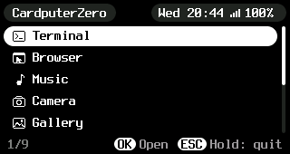
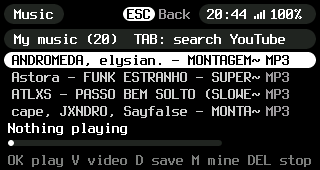

# Optic Suite for CardputerZero

A full-screen, keyboard-driven shell for the M5Stack CardputerZero's 320x170 screen:
terminal, browser, music, camera, gallery, sensors, network, HDMI and system pages in one app.

 

## Install

Download `optic-cardputerzero_<version>_arm64.deb` from the
[OpticSuite releases](https://github.com/zedward856-spec/OpticSuite/releases), copy it to the device, then:

    sudo apt install ./optic-cardputerzero_<version>_arm64.deb

It appears in the launcher as **Optic Suite**.

## Build

Desktop (SDL) build for development:

    cmake --preset linux-x86-64 && cmake --build build/desktop

The device package is built by `tools/build-cpz-debs.sh` in the OpticSuite repository.

## Credits and licence

Based on the [CardputerZero Template](https://github.com/CardputerZero/Template) (MIT; its original
readme is kept as `TEMPLATE-README.md`). MIT licence, see `LICENSE`. Fonts carry their own
licences, see `assets/fonts/LICENSE.txt`.
